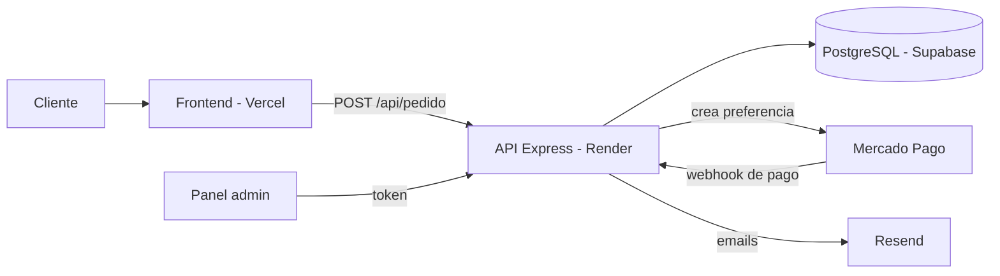

# GG'SNK — Tienda online de zapatillas importadas

Tienda online de zapatillas retro runner importadas (ASICS, New Balance, Adidas y Nike), con pagos por Mercado Pago y panel de administración propio.

**Sitio:** [ggsnk.store](https://ggsnk.store)

## Qué hace

- **Catálogo** por marca, modelo y color, con fotos de producto y fotos de control de calidad (QC) de cada par.
- **Pedidos online:** el cliente arma el carrito y el backend guarda el pedido en PostgreSQL.
- **Pago con Mercado Pago:** se crea una preferencia de pago por pedido y un webhook confirma el pago y pasa el pedido a "Pagado".
- **Emails automáticos** (Resend) a la tienda y al cliente cuando entra un pedido y cuando se confirma el pago.
- **WhatsApp** como alternativa, con el detalle del pedido armado.
- **Seguimiento** del pedido por número.
- **Panel de administración** (`ggsadmin.html`): login, listado y edición de pedidos (estado, tracking, notas, costo), carga de pedidos manuales y estadísticas de pedidos por estado, ingresos y ganancia.

## Stack

| Parte | Tecnología | Deploy |
| --- | --- | --- |
| Frontend | HTML, CSS y JavaScript | Vercel |
| Backend | Node.js + Express | Render |
| Base de datos | PostgreSQL | Supabase |
| Pagos | Mercado Pago (SDK oficial) | — |
| Emails | Resend | — |

## Arquitectura



## API

| Método | Ruta | Para qué | Protegida |
| --- | --- | --- | --- |
| POST | `/api/pedido` | Crea el pedido y la preferencia de pago | No |
| POST | `/api/webhook/mercadopago` | Recibe la confirmación de pago | No |
| GET | `/api/seguimiento/:id` | Estado de un pedido | No |
| POST | `/api/admin/login` | Login del panel | Rate limit |
| GET | `/api/pedidos` | Lista de pedidos | Sí |
| POST | `/api/pedido/manual` | Carga un pedido a mano | Sí |
| PUT | `/api/pedido/:id` | Edita un pedido | Sí |
| DELETE | `/api/pedido/:id` | Borra un pedido | Sí |
| GET | `/api/stats` | Estadísticas | Sí |
| GET | `/api/status` | Estado del servidor | No |

## Seguridad

- Login del panel con límite de 10 intentos cada 15 minutos por IP y token firmado con HMAC.
- CORS limitado a los dominios de la tienda.
- Credenciales solo en variables de entorno; el `.env` no se sube al repo.

## Correrlo local

```bash
cd backend
npm install
cp .env.example .env   # completar con tus datos
npm run dev
```

Variables que usa el servidor: `DATABASE_URL`, `ADMIN_PASSWORD`, `TOKEN_SECRET`, `MP_ACCESS_TOKEN`, `RESEND_API_KEY`, `EMAIL_DESTINO`, `WHATSAPP_NUMERO`, `FRONTEND_URL`, `BACKEND_URL`, `PORT` y `NODE_ENV`.

## Autor

Lautaro Gil — [LinkedIn](https://www.linkedin.com/in/lautarogil-dev) · [GitHub](https://github.com/LauchaGil)
